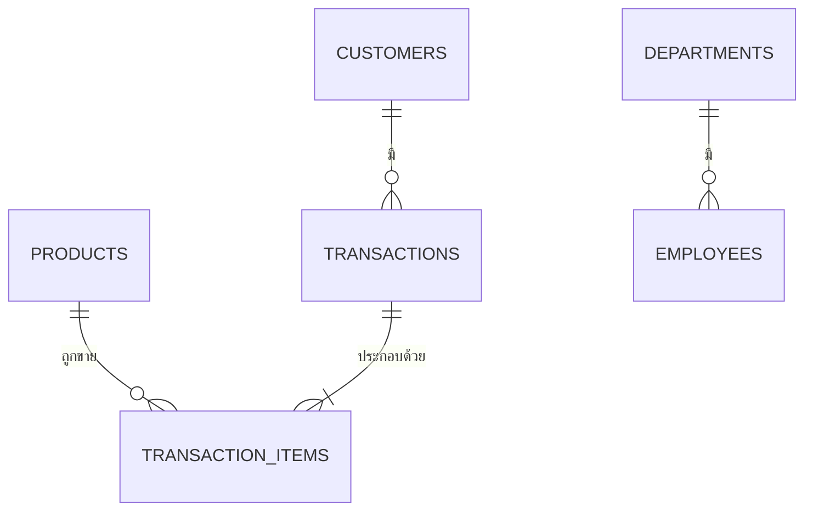

# แผนงานการให้คำปรึกษาเชิงลึก 4 Manday (Day 1 - Day 4)

โครงการ: การวินิจฉัย ออกแบบฐานข้อมูล บูรณาการข้อมูล และพัฒนาแดชบอร์ดวิเคราะห์ข้อมูล
เครื่องมือหลักของโครงการ: **Insightful – AI Data Analyst** (React/Vite, Express, SQLite/MySQL/PostgreSQL)
ผู้จัดทำ: ____________________  สถานประกอบการ: ____________________  วันที่: ____________________

---

## ภาพรวมการจัดสรรเวลา

| Manday | หัวข้อหลัก | เวลาขั้นต่ำ | ผลลัพธ์หลัก |
|---|---|---|---|
| 1 | วินิจฉัยสถานประกอบการ | ≥ 6 ชม. | ทะเบียนแหล่งข้อมูล, รายงานวินิจฉัย, แผนให้คำปรึกษาและระยะเวลา |
| 2 | ออกแบบโครงสร้างฐานข้อมูลและ Front-end | ≥ 6 ชม. | Data Dictionary, ERD, แบบฟอร์มเพิ่ม/แก้ไข, ฟังก์ชันค้นหา/กรอง, คู่มือการใช้งาน |
| 3 | การเชื่อมโยงและบูรณาการข้อมูล | ≥ 6 ชม. | แผนผังการไหลข้อมูล, สคริปต์/ขั้นตอน Transform, ตาราง Mapping, ผลทดสอบ Import |
| 4 | วิเคราะห์ข้อมูลและแดชบอร์ด (BI) | ≥ 6 ชม. | แดชบอร์ด, Analytical Report, ผลทดสอบความถูกต้อง, ข้อเสนอแนะการปรับปรุง |

---

## Manday ที่ 1 — วินิจฉัยสถานประกอบการ (≥ 6 ชั่วโมง)

### ช่วงเวลาโดยประมาณ
| เวลา | กิจกรรม | ผลลัพธ์ |
|---|---|---|
| 09:00–10:00 (1 ชม.) | ประชุมเปิดโครงการ ทำความเข้าใจเป้าหมายและขอบเขต | บันทึกการประชุม, รายชื่อผู้ประสานงาน |
| 10:00–11:30 (1.5 ชม.) | 1) สำรวจแหล่งข้อมูลเดิม (Data Sources) | ทะเบียนแหล่งข้อมูล (ตารางด้านล่าง) |
| 11:30–12:30 (1 ชม.) | พักกลางวัน | – |
| 12:30–14:00 (1.5 ชม.) | 2) ประเมินความพร้อมด้านดิจิทัลและเทคโนโลยี ตรวจสอบคุณภาพข้อมูล | แบบประเมินความพร้อม, รายงานคุณภาพข้อมูล |
| 14:00–15:30 (1.5 ชม.) | 3) วิเคราะห์ปัญหาและรวบรวมความต้องการทางธุรกิจ (Requirement Gathering) | ตาราง Requirement, กระบวนการธุรกิจหลัก |
| 15:30–16:30 (1 ชม.) | 4) กำหนดบทบาทผู้ใช้เบื้องต้นและสรุปผล | ตารางบทบาทผู้ใช้, สรุปรายงานวินิจฉัย |
| รวม | | **≥ 6 ชั่วโมง** |

### 1) สำรวจแหล่งข้อมูลที่มีอยู่เดิม
สำรวจทุกแหล่งที่มีการเก็บข้อมูล ทั้งกระดาษ ไฟล์ Excel/CSV และระบบซอฟต์แวร์ บันทึกลงตารางนี้:

| รหัส | แหล่งข้อมูล | ประเภท (กระดาษ/Excel/CSV/ระบบ/อื่นๆ) | แผนก/ผู้รับผิดชอบ | ข้อมูลที่เก็บ | ความถี่การอัปเดต | รูปแบบ/ตัวอย่างไฟล์ | ปัญหาที่พบ |
|---|---|---|---|---|---|---|---|
| DS-01 | | | | | | | |
| DS-02 | | | | | | | |
| DS-03 | | | | | | | |

แนวทางการสำรวจ: ขอตัวอย่างเอกสารจริง (ย้อนหลังอย่างน้อย 3 เดือน), ตรวจสอบว่ามีการคีย์ข้อมูลซ้ำระหว่างกระดาษกับ Excel หรือไม่, สอบถามว่าใครเป็นเจ้าของข้อมูลแต่ละชุด

### 2) ประเมินความพร้อมด้านดิจิทัลและเทคโนโลยี และตรวจสอบคุณภาพข้อมูล

**2.1 ความพร้อมด้านดิจิทัล (ให้คะแนน 1–5)**

| หัวข้อ | คะแนน | หมายเหตุ |
|---|---|---|
| อุปกรณ์และอินเทอร์เน็ตของผู้ใช้งาน | | |
| การใช้ Excel / Spreadsheet ของพนักงาน | | |
| มีระบบ ERP / ระบบบัญชี / ระบบ POS หรือไม่ | | |
| มีฐานข้อมูลส่วนกลางหรือไม่ (MySQL/PostgreSQL) | | |
| ทักษะด้าน IT ของทีมงาน | | |
| นโยบายความปลอดภัยและการสำรองข้อมูล | | |
| งบประมาณและการอนุมัติเครื่องมือ | | |

**2.2 ตรวจสอบคุณภาพข้อมูล (Data Quality Check)**

| มิติ | วิธีตรวจ | ตัวอย่างผลที่พบ | ระดับความรุนแรง (สูง/กลาง/ต่ำ) |
|---|---|---|---|
| ความถูกต้อง (Accuracy) | เทียบยอดกับเอกสารต้นทาง | | |
| ความสมบูรณ์ (Completeness) | นับค่าว่าง (null) ต่อคอลัมน์ | | |
| ความสอดคล้อง (Consistency) | ชื่อเดียวกันเขียนต่างกัน เช่น "กรุงเทพ"/"กทม." | | |
| ความซ้ำซ้อน (Duplication) | ตรวจรหัสซ้ำ | | |
| รูปแบบ/ชนิดข้อมูล (Validity) | วันที่, ตัวเลข, รหัส ผิดรูปแบบหรือไม่ | | |
| ความทันสมัย (Timeliness) | ข้อมูลล่าสุดเมื่อใด | | |

**2.3 ตรวจสอบโครงสร้างข้อมูล:** จำนวนคอลัมน์/ตาราง, ความสัมพันธ์ระหว่างไฟล์ (มีรหัสร่วมหรือไม่), แถวหัวตารางซ้อน, เซลล์รวม (merged cells), สูตร Excel ที่ซ่อนอยู่

> การตรวจสอบเบื้องต้นทำได้โดยอัปโหลด CSV ผ่านเมนู **Upload file** ของแอป เพื่อดูชนิดคอลัมน์และสรุปข้อมูลอัตโนมัติ และถ้าสถานประกอบการมีฐานข้อมูล ให้ใช้ **Connect data** → Test connection → Load preview (สูงสุด 50 แถว)

### 3) วิเคราะห์ปัญหาและรวบรวมความต้องการทางธุรกิจ (Requirement Gathering)

**3.1 ปัญหาที่พบ (Problem Statement)**

| รหัส | ปัญหา | ผลกระทบต่อธุรกิจ | แผนก | สาเหตุเบื้องต้น |
|---|---|---|---|---|
| P-01 | | | | |
| P-02 | | | | |
| P-03 | | | | |

**3.2 ความต้องการทางธุรกิจ (Business Requirements)**

| รหัส | ความต้องการ | ผู้ต้องการ | ระดับความสำคัญ (Must/Should/Could) | เกณฑ์การยอมรับ (Acceptance Criteria) |
|---|---|---|---|---|
| BR-01 | | | | |
| BR-02 | | | | |
| BR-03 | | | | |

**3.3 กระบวนการทางธุรกิจที่สำคัญ (Key Business Processes)**
ระบุกระบวนการ 3–5 รายการที่สร้างหรือใช้ข้อมูลมากที่สุด เช่น การรับคำสั่งซื้อ, การจัดซื้อ, การเบิกจ่าย, การผลิต, การขาย, การจัดการสต็อก ให้วาดขั้นตอนอย่างง่าย (Input → Process → Output) และระบุว่าข้อมูลถูกบันทึกที่ใด โดยใคร

### 4) การประยุกต์ใช้ฐานข้อมูลและกำหนดบทบาทผู้ใช้

**4.1 แนวทางการใช้ฐานข้อมูลเพื่อสนับสนุนการดำเนินกิจการ** (ตัวอย่าง)
- รวมข้อมูลจากกระดาษและ Excel เข้าฐานข้อมูลส่วนกลางเพียงแห่งเดียว (Single Source of Truth)
- กำหนดรหัสมาตรฐาน เช่น รหัสลูกค้า รหัสสินค้า รหัสพนักงาน
- ลดการคีย์ข้อมูลซ้ำ และมี Dashboard สำหรับติดตามตัวชี้วัด (KPI) ประจำวัน/เดือน

**4.2 กำหนดบทบาทผู้ใช้ (User Roles)**

| บทบาท | ผู้รับผิดชอบ | สิทธิ์การใช้งาน | ข้อมูลที่เข้าถึงได้ |
|---|---|---|---|
| Superuser / ผู้ดูแลระบบ | IT | ตั้งค่าฐานข้อมูล, จัดการผู้ใช้ | ทั้งหมด |
| Manager / ผู้บริหาร | ผู้จัดการ | ดู Dashboard, ส่งออกรายงาน | ข้อมูลสรุปทุกแผนก |
| Data Entry / เจ้าหน้าที่บันทึกข้อมูล | พนักงานแผนก | เพิ่ม/แก้ไขข้อมูลของแผนกตน | ข้อมูลในแผนกตน |
| Viewer / ผู้ตรวจสอบ | ฝ่ายตรวจสอบ | ดูอย่างเดียว | ตามที่กำหนด |

### 5) ผลลัพธ์ที่ต้องส่งมอบใน Day 1 (จัดทำเป็นรายงานตามข้อ 1–2)

**(1) ผลการวินิจฉัยด้านการบริหารจัดการข้อมูลในปัจจุบันของสถานประกอบการ**
- สรุปแหล่งข้อมูล ความพร้อมด้านดิจิทัล คุณภาพข้อมูล ปัญหาหลัก และกระบวนการสำคัญ
- คะแนนวุฒิภาวะการจัดการข้อมูล (ระดับ 1 เริ่มต้น – 5 ขั้นสูง) พร้อมเหตุผลประกอบ

**(2) แผนการให้คำปรึกษาแนะนำเชิงลึกและระยะเวลาดำเนินงาน**

| ลำดับ | กิจกรรม | Day | ผู้รับผิดชอบ | ระยะเวลา | ผลลัพธ์ที่คาดหวัง |
|---|---|---|---|---|---|
| 1 | จัดทำ Data Dictionary และ ERD | Day 2 | | | |
| 2 | ออกแบบแบบฟอร์มและการค้นหา/กรองข้อมูล | Day 2 | | | |
| 3 | อบรมการใช้งานระบบที่ปรับปรุงใหม่ | Day 2 | | | |
| 4 | วิเคราะห์ความสัมพันธ์และ Mapping ข้อมูลระหว่างแผนก | Day 3 | | | |
| 5 | ทดสอบ Import/Transform ข้อมูลจริง | Day 3 | | | |
| 6 | ออกแบบ Dashboard และ Analytical Report | Day 4 | | | |
| 7 | ทดสอบความถูกต้องร่วมกับสถานประกอบการ | Day 4 | | | |
| 8 | ติดตามผลหลังการอบรม (30 วัน) | หลัง Day 4 | | | |

---

## Manday ที่ 2 — ออกแบบโครงสร้างฐานข้อมูลและ Front-end (≥ 6 ชั่วโมง)

### ช่วงเวลาโดยประมาณ
| เวลา | กิจกรรม |
|---|---|
| 09:00–10:30 (1.5 ชม.) | ทบทวนผล Day 1 และยืนยัน Requirement กับผู้ใช้ |
| 10:30–12:00 (1.5 ชม.) | วิเคราะห์และออกแบบโครงสร้างข้อมูล: รายการข้อมูล, ประเภทข้อมูล, รหัสอ้างอิง |
| 13:00–14:30 (1.5 ชม.) | ออกแบบความสัมพันธ์ (ERD) และกฎการตรวจสอบข้อมูล (Validation Rules) |
| 14:30–16:00 (1.5 ชม.) | ออกแบบ Front-end: แบบฟอร์มเพิ่ม/แก้ไข, การค้นหาและกรอง |
| 16:00–16:30 (0.5 ชม.) | แนะนำเครื่องมือ (Spreadsheet / ระบบฐานข้อมูล) และนัดติดตามผล |
| **รวม** | **≥ 6 ชั่วโมง** (รวมการอบรมความรู้ใหม่ 1 ชม. ในช่วงบ่าย) |

### 1) การออกแบบโครงสร้างข้อมูล (Database Schema Design)

**1.1 Data Dictionary (ตัวอย่างโครงสร้าง ปรับตามผล Day 1)**

| ตาราง | คอลัมน์ | ประเภทข้อมูล | ความยาว | Primary/Foreign Key | Required | ค่ามาตรฐาน / รหัสอ้างอิง | คำอธิบาย |
|---|---|---|---|---|---|---|---|
| customers | customer_id | INTEGER / VARCHAR(10) | | PK | ✔ | รหัส C-xxxx | รหัสลูกค้า |
| customers | customer_name | VARCHAR(200) | 200 | | ✔ | | ชื่อลูกค้า |
| customers | tax_id | VARCHAR(13) | 13 | | | เลขประจำตัวผู้เสียภาษี 13 หลัก | |
| products | product_id | VARCHAR(20) | 20 | PK | ✔ | รหัส P-xxxx | |
| transactions | transaction_id | BIGINT | | PK | ✔ | | |
| transactions | customer_id | VARCHAR(10) | | FK → customers | ✔ | | |
| transactions | txn_date | DATE | | | ✔ | YYYY-MM-DD | วันที่ทำรายการ |
| transactions | amount | DECIMAL(14,2) | | | ✔ | บาท | จำนวนเงิน |
| departments | department_code | VARCHAR(10) | | PK | ✔ | | |

ปรับรายการตารางตามกระบวนการหลักที่ได้จาก Day 1 เช่น การขาย, การซื้อ, สต็อก, พนักงาน, งบประมาณ

**1.2 ความสัมพันธ์ของข้อมูล (ERD)** — วาดด้วย draw.io, dbdiagram.io หรือ Mermaid:


**1.3 หลักการออกแบบที่ต้องยึด**
- ทุกตารางมี Primary Key ที่ไม่ซ้ำ และใช้รหัสมาตรฐานที่กำหนดร่วมกับผู้ใช้
- ไม่เก็บข้อมูลซ้ำในหลายตาราง (Normalization ระดับ 3NF สำหรับข้อมูลธุรกรรม)
- กำหนดชนิดข้อมูลวันที่/เงิน/จำนวนให้ชัดเจน (เช่น เงินใช้ DECIMAL ไม่ใช้ FLOAT)
- กำหนดค่าที่อนุญาต (Lookup/Enum) เช่น สถานะ: ร่าง / อนุมัติ / ยกเลิก
- บันทึก created_at, updated_at, created_by เพื่อการตรวจสอบย้อนหลัง
- ไม่ใช้ค่าว่างแทนค่าที่ไม่ทราบ ให้ใช้ค่าเฉพาะหรือกำหนดกฎ

**1.4 การตั้งค่าในแอป:** ใช้ **Admin settings → Application database** เพื่อเลือก SQLite3 (ทดสอบ/ขนาดเล็ก), MySQL หรือ PostgreSQL (ใช้งานจริง) ทดสอบด้วย **Test connection** ก่อน **Save and switch** และตั้งค่า `ENCRYPTION_KEY` ใน `.env` ให้เรียบร้อยก่อนบันทึกรหัสผ่านฐานข้อมูล

### 2) การพัฒนา Front-end และอินเทอร์เฟซ

**2.1 แบบฟอร์มเพิ่ม/แก้ไขข้อมูล (Form Design)**

| ฟอร์ม | ฟิลด์สำคัญ | ประเภทควบคุม (Input) | กฎการตรวจสอบ (Validation) | ข้อความแจ้งเตือน |
|---|---|---|---|---|
| ลงทะเบียนลูกค้า | ชื่อ, เลขผู้เสียภาษี | Text, Text (13 หลัก) | ไม่ว่าง, ตัวเลข 13 หลัก, ไม่ซ้ำ | "เลขผู้เสียภาษีต้องมี 13 หลัก" |
| บันทึกรายการขาย | วันที่, รหัสลูกค้า, จำนวนเงิน | Date picker, Dropdown (lookup), Number | วันที่ไม่เกินวันนี้, เงิน > 0 | |

หลักการ UX: ใช้ Dropdown จากตารางอ้างอิงแทนการพิมพ์อิสระ, ค่าเริ่มต้นสำหรับฟิลด์ที่ใช้บ่อย, บันทึกแบบ Draft ได้, แสดงข้อความภาษาไทยทุกจุด

**2.2 การค้นหาและกรองข้อมูล (Search & Filter)**

| หน้าจอ | ตัวค้นหา | ตัวกรอง | การเรียงลำดับ | ส่งออก |
|---|---|---|---|---|
| รายการลูกค้า | ชื่อ/รหัส | แผนก, สถานะ | ชื่อ A–Z | CSV |
| รายการขาย | เลขที่รายการ | ช่วงวันที่, ลูกค้า, ยอดเงิน | วันที่ล่าสุด | CSV |

ในแอปปัจจุบัน ทำได้ผ่านการอัปโหลด CSV และการเลือก Dataset ใน **Ask your data** / ตัวกรองของแดชบอร์ด ส่วนการเชื่อมต่อ PostgreSQL/MySQL ให้เลือกตารางและดูตัวอย่างสูงสุด 50 แถวก่อนใช้งาน

**2.3 ผู้ใช้งานและสิทธิ์ (UI ตามบทบาท)**
- ซ่อนเมนูที่ไม่มีสิทธิ์ (เช่น Admin settings สำหรับ Superuser เท่านั้น)
- หน้า Login ใช้ Auth.jsx และตรวจสอบสิทธิ์ที่ฝั่งเซิร์ฟเวอร์ทุกครั้ง (ไม่พึ่งเฉพาะการซ่อนปุ่มบนหน้าจอ)

### 3) เครื่องมือที่แนะนำตามความพร้อม

| ระดับความพร้อม | เครื่องมือ | เหมาะกับ |
|---|---|---|
| เริ่มต้น | Excel/Google Sheets ที่มี Data Validation และ Named Range | ข้อมูลน้อย, ทีมที่คุ้นกับ Excel |
| กลาง | Insightful + SQLite3 (ไฟล์เดียว) | ทีมเล็ก, ทดลองใช้, ไม่ต้องติดตั้งเซิร์ฟเวอร์ฐานข้อมูล |
| ขั้นสูง | Insightful + MySQL/PostgreSQL | หลายผู้ใช้พร้อมกัน, ข้อมูลจำนวนมาก, ต้องการสำรองข้อมูลและควบคุมสิทธิ์ |

### 4) การอบรมและติดตามผล (ช่วงบ่ายของ Day 2)
- อบรม 1 ชั่วโมงแยกตามบทบาท: Data Entry (การกรอกฟอร์มและตรวจสอบข้อผิดพลาด), Manager (การอ่าน Dashboard), Superuser (การตั้งค่าฐานข้อมูลและสำรองข้อมูล)
- แจก **คู่มือการใช้งาน (Quick Guide)** 1–2 หน้าต่อบทบาท
- ทำแบบทดสอบสั้น 5 ข้อ เพื่อวัดความเข้าใจ
- นัดติดตามผลหลังใช้งานจริง 1 สัปดาห์ (ตรวจอัตราการกรอกข้อมูลซ้ำและจำนวนข้อผิดพลาดที่ลดลง)

### ผลลัพธ์ที่ต้องส่งมอบ Day 2
- Data Dictionary (ฉบับ v1.0) และ ERD
- รายการ Validation Rules
- Mockup หรือต้นแบบแบบฟอร์มและหน้าค้นหา/กรอง
- Quick Guide ตามบทบาท และผลแบบทดสอบ
- รายการเอกสารที่เสร็จและงานค้าง

---

## Manday ที่ 3 — การเชื่อมโยงและบูรณาการข้อมูล (≥ 6 ชั่วโมง)

### ช่วงเวลาโดยประมาณ
| เวลา | กิจกรรม |
|---|---|
| 09:00–10:30 (1.5 ชม.) | วิเคราะห์ความสัมพันธ์ของข้อมูลระหว่างแผนก (Cross-department mapping) |
| 10:30–12:00 (1.5 ชม.) | ออกแบบแนวทางเชื่อมโยงตามข้อจำกัดเทคโนโลยีของแต่ละสถานประกอบการ |
| 13:00–14:30 (1.5 ชม.) | พัฒนาขั้นตอน Data Collection, Transformation และ Integration |
| 14:30–16:00 (1.5 ชม.) | ทดสอบการ Import จริง ตรวจผลลัพธ์ และแก้ไขข้อมูลที่ผิด |
| 16:00–16:30 (0.5 ชม.) | สรุปและบันทึกขั้นตอนเพื่อใช้ซ้ำ |
| **รวม** | **≥ 6 ชั่วโมง** |

### 1) วิเคราะห์ความสัมพันธ์ของข้อมูลระหว่างแผนก

| จากแผนก | ข้อมูลที่ส่ง | ไปแผนก | ข้อมูลที่รับ | คีย์เชื่อมโยง | ความถี่ | วิธีส่งในปัจจุบัน | ปัญหา |
|---|---|---|---|---|---|---|---|
| ขาย | ใบสั่งซื้อ | คลัง | รายการสินค้า | product_id | รายวัน | อีเมล/Excel | ชื่อสินค้าไม่ตรงกัน |
| | | | | | | | |

### 2) ออกแบบแนวทางการเชื่อมโยงตามข้อจำกัดเทคโนโลยี

| ระดับเทคโนโลยี | วิธีเชื่อมโยง | ข้อดี | ข้อจำกัด |
|---|---|---|---|
| ไฟล์ CSV/Excel เป็นระยะ | อัปโหลด CSV ผ่านเมนู Upload file ตามแม่แบบมาตรฐาน | ไม่ต้องมี IT เพิ่ม | ต้องทำซ้ำด้วยมือ, เสี่ยงผิดพลาด |
| ฐานข้อมูล MySQL/PostgreSQL | Connect data → เลือกตาราง → Use this data | ข้อมูลเป็นปัจจุบัน | ต้องได้สิทธิ์และ TLS, ไม่บันทึก URL ในเบราว์เซอร์ |
| ระบบที่มีอยู่ (ERP/POS) | ส่งออกเป็น CSV หรือเชื่อมผ่าน Database View | ใช้ระบบเดิมได้ | ขึ้นกับผู้ขายซอฟต์แวร์ |

> หมายเหตุ: ปัจจุบัน Google Sheets/Drive ยังไม่รองรับการเชื่อมต่อสด (Live) ให้ส่งออกเป็น CSV ก่อน

### 3) กระบวนการรวบรวม แปลงรูปแบบ และเชื่อมโยงข้อมูล (ETL)

**ขั้นที่ 1 — Data Collection (รวบรวม)**
- กำหนดชื่อไฟล์และโฟลเดอร์มาตรฐาน เช่น `input/ขาย/2026-01.csv`
- กำหนดกำหนดเวลาการส่งข้อมูลและผู้รับผิดชอบ

**ขั้นที่ 2 — Transformation (แปลงรูปแบบ)**

| กฎการแปลง | ตัวอย่าง input | ตัวอย่าง output |
|---|---|---|
| ปรับวันที่เป็น ISO | 01/02/2569 | 2026-02-01 (ตรวจปี พ.ศ. → ค.ศ. ให้ถูกต้อง) |
| ตัดช่องว่างและทำให้เป็นมาตรฐาน | " กรุงเทพ " | "กรุงเทพฯ" |
| แปลงรหัสเก่าเป็นรหัสใหม่ | C-0012 | C-00012 |
| เติมค่าหรือแจ้งค่าว่าง | (ว่าง) | แจ้งเตือนให้แก้ไข ไม่เติมเอง |
| ตัด/รวมแถวซ้ำ | รหัสซ้ำ 2 แถว | เก็บแถวล่าสุด + บันทึก log |

**ขั้นที่ 3 — Integration (เชื่อมโยง)**
- จับคู่ตารางด้วยคีย์ร่วม (Join) เช่น customer_id
- ตรวจ Referential Integrity: ทุก FK ต้องมีค่าใน PK ของตารางอ้างอิง
- จัดทำตาราง Mapping รหัสระหว่างระบบเก่ากับระบบใหม่

**ตัวอย่างตาราง Mapping**

| ระบบต้นทาง | รหัสต้นทาง | ชื่อต้นทาง | รหัสปลายทาง | ชื่อมาตรฐาน | หมายเหตุ |
|---|---|---|---|---|---|
| Excel ขาย | P-A01 | ปูนซีเมนต์ 50 kg | P-0001 | ปูนซีเมนต์ 50 กก. | |

### 4) ทดสอบการ Import และตรวจสอบผล

| รหัสทดสอบ | สิ่งที่ทดสอบ | ข้อมูลตัวอย่าง | ผลที่คาดหวัง | ผลจริง | ผ่าน/ไม่ผ่าน |
|---|---|---|---|---|---|
| IT-01 | อัปโหลด CSV ที่ถูกต้อง | ไฟล์ขาย 100 แถว | แสดงสรุปและกราฟ 100 แถว | | |
| IT-02 | อัปโหลดไฟล์วันที่ผิดรูปแบบ | วันที่ "32/13/2026" | แจ้งเตือนและไม่นำเข้าแถวนั้น | | |
| IT-03 | เชื่อมตาราง PostgreSQL/MySQL | ตาราง transactions | Preview ได้ไม่เกิน 50 แถว | | |
| IT-04 | Join ลูกค้ากับรายการขาย | customer_id | ไม่มี FK หลุด | | |
| IT-05 | ตรวจยอดรวมหลัง Transform | ยอดรวมต้นทาง | ตรงกันทุกสตางค์ | | |

### ผลลัพธ์ที่ต้องส่งมอบ Day 3
- แผนผังการไหลข้อมูล (Data Flow Diagram) ระหว่างแผนก
- ตาราง Mapping รหัสและชื่อมาตรฐาน
- ขั้นตอนหรือสคริปต์ Transform (เอกสารขั้นตอนทีละขั้น)
- ผลการทดสอบ Import และรายการข้อมูลที่ยังต้องแก้ไขโดยเจ้าของข้อมูล

---

## Manday ที่ 4 — การวิเคราะห์ข้อมูลและพัฒนาเครื่องมือแสดงผล (≥ 6 ชั่วโมง)

### ช่วงเวลาโดยประมาณ
| เวลา | กิจกรรม |
|---|---|
| 09:00–10:30 (1.5 ชม.) | กำหนด KPI และตัวชี้วัดร่วมกับผู้บริหาร |
| 10:30–12:00 (1.5 ชม.) | ออกแบบ Dashboard และเลือกกราฟที่เหมาะสม |
| 13:00–14:30 (1.5 ชม.) | พัฒนา/ปรับแต่งแดชบอร์ดและ Analytical Report |
| 14:30–15:30 (1 ชม.) | ทดสอบความถูกต้องของการประมวลผลและการแสดงผลร่วมกับสถานประกอบการ |
| 15:30–16:30 (1 ชม.) | แปลผล ข้อเสนอแนะเชิงกลยุทธ์ และปรับปรุงเครื่องมือ |
| **รวม** | **≥ 6 ชั่วโมง** |

### 1) กำหนดตัวชี้วัด (KPI Definition)

| KPI | สูตรคำนวณ | แหล่งข้อมูล | ความถี่ | เป้าหมาย | ผู้รับผิดชอบ |
|---|---|---|---|---|---|
| ยอดขายรวม | SUM(amount) | transactions | รายเดือน | | |
| อัตราการชำระเงินตรงเวลา | จำนวนที่ชำระตรงเวลา / จำนวนทั้งหมด × 100 | | | | |
| ต้นทุนต่อหน่วย | ต้นทุนรวม / ปริมาณผลิต | | | | |
| อัตราข้อมูลไม่สมบูรณ์ | แถวที่มีค่าว่าง / แถวทั้งหมด × 100 | | | ≤ 2% | |

### 2) ออกแบบและพัฒนาแดชบอร์ด (Dashboard Design & Visualization)

**โครงสร้างแดชบอร์ดแนะนำ**
- แถวบน: KPI Cards (ยอดรวม, อัตราการเปลี่ยนแปลงจากงวดก่อน, จำนวนรายการ, อัตราข้อมูลไม่สมบูรณ์)
- แถวกลาง: กราฟแนวโน้มรายเดือน (Line), การเปรียบเทียบแผนก (Bar), สัดส่วน (Pie/Donut ไม่เกิน 5 หมวด)
- แถวล่าง: ตารางรายละเอียดพร้อมตัวกรอง และ Dataset Preview

**หลักการเลือกกราฟ**

| วัตถุประสงค์ | กราฟที่เหมาะสม | หลีกเลี่ยง |
|---|---|---|
| ดูแนวโน้มตามเวลา | Line / Area | Pie |
| เปรียบเทียบหมวด | Bar (แนวนอนเมื่อชื่อยาว) | 3D |
| สัดส่วน | Donut (≤5 หมวด) | Pie ที่มีหลายชิ้น |
| ความสัมพันธ์ 2 ตัวแปร | Scatter | Line |

**การใช้งานในแอป:** อัปโหลด CSV หรือเชื่อมตาราง → ตรวจ Dataset ที่เลือก → เลือกคอลัมน์แกน X/Y ในแดชบอร์ด (FreeCharts / Recharts) → บันทึกมุมมองที่ใช้บ่อย

### 3) รายงานเชิงวิเคราะห์ (Analytical Report)

โครงสร้างรายงานต่อสถานประกอบการ:
1. **บทสรุปผู้บริหาร (Executive Summary)** — 3–5 ประเด็นสำคัญ
2. **สถานการณ์ปัจจุบัน** — KPI หลัก เทียบกับเป้าหมายและงวดก่อน
3. **การวิเคราะห์แนวโน้ม** — ทิศทาง, ฤดูกาล, จุดผิดปกติ (Anomaly) และคำอธิบายที่เป็นไปได้
4. **การวิเคราะห์สาเหตุ** — แยกตามแผนก/สินค้า/ลูกค้า
5. **ข้อเสนอแนะเชิงกลยุทธ์** — ระบุผู้รับผิดชอบ กำหนดเวลา และผลที่คาดหวัง
6. **ข้อจำกัดของข้อมูล** — ความสมบูรณ์ ความทันสมัย และสมมติฐานที่ใช้

> ใช้ **Ask your data** ช่วยสรุปเบื้องต้นได้ แต่ผู้วิเคราะห์ต้องตรวจสอบตัวเลขและตีความเองก่อนนำเสนอ (AI สรุปอาจคลาดเคลื่อน)

**การนำไปใช้ในการตัดสินใจ**
- การวางแผน: ใช้แนวโน้มยอดขายกำหนดสต็อกและงบประมาณ
- การติดตามสถานการณ์: ตั้งเกณฑ์แจ้งเตือน เช่น KPI ต่ำกว่าเป้า 10% ติดต่อกัน 2 เดือน
- การตัดสินใจเชิงกลยุทธ์: เปรียบเทียบตัวเลือกพร้อมผลกระทบและความเสี่ยง

### 4) ทดสอบความถูกต้องของการประมวลผลและการแสดงผล

| รหัส | สิ่งที่ทดสอบ | วิธีตรวจ | ผลที่คาดหวัง | ผลจริง | ผ่าน/ไม่ผ่าน |
|---|---|---|---|---|---|
| AT-01 | ยอดรวมในแดชบอร์ด | เทียบกับ SUM ใน Excel ของต้นทาง | ตรงกันทุกหน่วย | | |
| AT-02 | ตัวกรองช่วงวันที่ | เลือกเดือนเดียวแล้วนับแถว | จำนวนแถวตรงกับ Excel | | |
| AT-03 | ค่าเฉลี่ย/อัตราร้อยละ | คำนวณตัวอย่าง 3 ค่าด้วยมือ | ตรงกับแดชบอร์ด | | |
| AT-04 | แกนกราฟและหน่วย | ตรวจป้ายกำกับและหน่วยเงิน (บาท) | ถูกต้องและอ่านง่าย | | |
| AT-05 | ภาษาไทยและการแสดงผลวันที่ | ตรวจข้อความและปี พ.ศ./ค.ศ. | แสดงถูกต้องครบถ้วน | | |
| AT-06 | การแสดงผลบนมือถือ | เปิดด้วยหน้าจอขนาดเล็ก | ไม่ล้น/ไม่ซ้อนทับ | | |
| AT-07 | สิทธิ์การเข้าถึง | Login ด้วยบทบาท Viewer | ไม่เห็นเมนูตั้งค่าฐานข้อมูล | | |

**การทดสอบร่วมกับสถานประกอบการ:** ให้เจ้าของข้อมูลเปรียบเทียบตัวเลข 3 รายงานกับระบบเดิม บันทึกความเห็นและลงนามรับรองผลการทดสอบ

**การทดสอบอัตโนมัติ (สำหรับทีมพัฒนา):** ในโปรเจกต์มีไฟล์ `src/csv.test.js` ให้รันด้วยคำสั่ง
```
npm run build
```
และตรวจสอบ `csv.test.js` ด้วย test runner ที่ติดตั้งไว้ (ถ้ายังไม่มีให้เพิ่มเอง)

### 5) การปรับปรุงเครื่องมือให้เหมาะสม

| ลำดับ | ข้อเสนอแนะจากการทดสอบ | ความสำคัญ | ผู้รับผิดชอบ | กำหนดเสร็จ |
|---|---|---|---|---|
| 1 | | | | |
| 2 | | | | |
| 3 | | | | |

### ผลลัพธ์ที่ต้องส่งมอบ Day 4
- แดชบอร์ดที่ใช้งานได้จริงตามบทบาท
- Analytical Report ฉบับแรกพร้อมข้อเสนอแนะเชิงกลยุทธ์
- ผลทดสอบความถูกต้อง (AT-01 ถึง AT-07) และลายมือชื่อรับรองจากสถานประกอบการ
- รายการปรับปรุงเครื่องมือและแผนการติดตามผล

---

## ภาพรวมผลลัพธ์ทั้ง 4 วัน (Checklist)

- [ ] ทะเบียนแหล่งข้อมูลและรายงานวินิจฉัย (Day 1)
- [ ] แผนให้คำปรึกษาเชิงลึกและระยะเวลาดำเนินงาน (Day 1)
- [ ] Data Dictionary, ERD, แบบฟอร์ม และ Quick Guide (Day 2)
- [ ] Data Flow, ตาราง Mapping และผลทดสอบ Import (Day 3)
- [ ] แดชบอร์ด, Analytical Report และผลทดสอบความถูกต้อง (Day 4)
- [ ] ลงนามรับรองผลร่วมกับสถานประกอบการ

## ข้อควรระวังและความปลอดภัยของข้อมูล
- ข้อมูลลูกค้า/พนักงานเป็นข้อมูลส่วนบุคคล ต้องได้รับอนุญาตก่อนนำเข้าระบบ และจำกัดสิทธิ์การเข้าถึง
- ตั้งค่า `ENCRYPTION_KEY` ที่เป็นความลับและสำรองไว้อย่างปลอดภัย ห้าม commit ลง Git
- สำรองไฟล์ `data/app.db` และฐานข้อมูลจริงก่อนทุกครั้งที่เปลี่ยนการตั้งค่า
- ใช้ TLS เมื่อเชื่อมต่อฐานข้อมูลผ่านเครือข่าย
